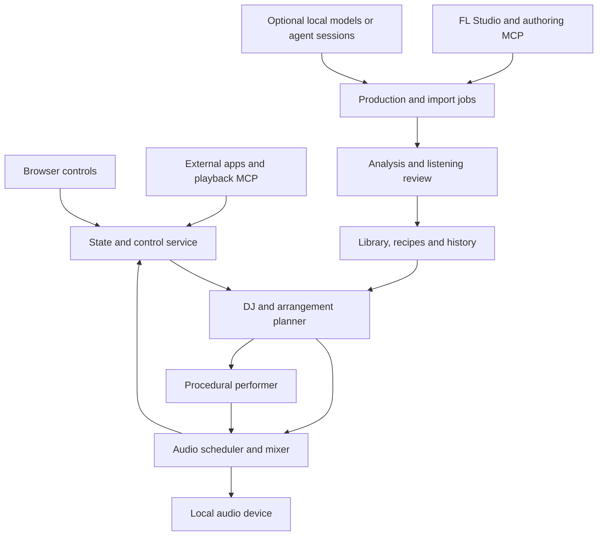

# Preliminary architecture

Document ID: `EM-D004`  
Status: proposed design, 2026-11-03. No component below is implemented in this repository.

## Main decision

Use a **local playback engine with a browser control interface** as the reference architecture. A browser-only renderer remains an option to measure in the initial backend spike. The system should not require a DAW, GPU model, or agent session merely to play an already approved library.

The musical director chooses a future arrangement. The audio engine performs it against one sample clock. Authoring tools produce assets and recipes ahead of time. This separation allows rich sound without asking the browser or a language model to invent and render the next beat under a deadline.

## Responsibilities

The boxes describe ownership boundaries, not a requirement for a separate process or microservice for each box. The first implementation should combine ordinary control/catalog/planning work in one service and keep only real-time rendering isolated where needed.

### Control service

Owns the requested state, its revision, manual overrides, source authority, settings and command receipts. It reports the audible state supplied by the engine rather than guessing that an accepted command has already taken effect.

State intent is consumer-neutral. The first test app supplies it directly. A later Mission Control adapter can derive it from activity without changing the music engine. An incoming “Surge” request is not an instruction to increase loudness or discard the current musical phrase.

### DJ and arrangement planner

Owns candidate selection, recency and diversity policy, compatible routes through the library, and the next prepared mix plan. It chooses between recorded and procedural sources, including a procedural bridge used to reach a recording that cannot be mixed directly.

It operates on phrase/section timescales. It can consider several alternatives and explain why one was selected. It must prepare an executable plan before asking the audio engine to use it. When no suitable plan is ready, the current approved material continues through a valid continuation or an explicit fallback.

### Procedural performer

Owns notes, rhythmic choices, expressive controls and bounded synthesis/sample playback inside a recipe. It receives the same musical timeline, harmonic plan and role allocation used by recorded sources.

It cannot independently change the global key or tempo while accompanying a recording. The arrangement plan may grant it a new harmonic section or a transition corridor. Recipes and seeds are versioned so a performance can be reproduced at the symbolic level; byte-identical audio requires additional control of plugins, DSP versions, assets and environment and is not assumed.

### Audio engine

Owns the sample clock, transport, scheduled commands, output buffering, decoding/streaming, gain ramps, effect tails, voice limits and the active mix. Control/network/model work stays outside its real-time callback.

One engine owns audible playback for a session. The initial backend permits **one audible session per selected output device**, including auditions. Starting another session or audition requires an explicit ownership transfer or returns a conflict; it cannot silently mix independent sessions. Browser tabs subscribe to the existing session. Opening a second tab must not start another soundtrack. Device changes and suspend/resume are explicit states, with a short bounded fade/recovery policy and visible status.

### Library and production workers

The library stores immutable assets and versioned descriptions; a local index supports search. Production workers run expensive or unreliable tasks: DAW rendering, model inference, analysis, sample conversion, offline time stretching and derived previews. Worker completion submits candidates for validation and listening review. It does not silently replace material in the live set.

## Proposed implementation baseline

These are starting candidates for EMF03, not installed dependencies or a locked stack.

| Area | Small initial proposal | Reason and decision test |
| --- | --- | --- |
| Browser UI | TypeScript with a small component layer | State controls, timeline and audition UI; avoid duplicating the planner in the frontend. |
| Control/catalog/jobs/MCP | One Python service, local SQLite index, files for immutable media | Shares an ecosystem with FL Piano roll scripting and production tooling; measure startup and packaging. |
| Real-time native output | A compiled audio worker, with C++/miniaudio as the leading small candidate | Playback, mixing and device support without putting Python or model work in the callback. |
| Browser renderer comparison | Web Audio with AudioWorklet where custom DSP is needed | Useful for a portable audition build; compare lifecycle, memory, timing and background behavior. |
| Time stretching | First use authored compatible tempos or cached variants; evaluate a dedicated library later | Quality, licensing, latency and multi-stem phase behavior require evidence. |
| Model execution | Optional job adapters, separate environment/process | No model dependency for ordinary playback; isolate GPU memory and failure. |

Miniaudio documents cross-platform playback/capture, decoding and mixing, and offers a permissive license choice. Its callback documentation also identifies operations that must not run inside the callback. It is a candidate foundation, not a complete adaptive music engine. [A1], [A2]

AudioWorklet supplies audio processing outside the browser's main UI thread. It does not by itself solve lifecycle suspension, long-library memory, musical arrangement or recovery. [A3]

The backend spike should prefer the smallest solution that passes a two-deck/stem transition, a procedural voice test, bounded resource use, device recovery, and basic background operation. Do not build both production backends before one works. Record the decision and revisit only when an actual limitation warrants it.

## Shared musical timeline

Use a monotonic audio sample counter for execution and an explicit mapping to musical time. Wall-clock time is for logs, not for scheduling a beat.

A transport snapshot contains sample rate, sample position, tempo map, meter map, bar/beat position, transport status, and a generation/revision number. Bar lengths are derived from meter; the core contract must not silently assume every genre uses 4/4.

An arrangement plan adds:

- Section identity and start/end positions.
- Harmonic regions: key/mode where meaningful, chord timeline, tuning reference and confidence.
- Instrument roles: who owns kick, sub/bass, harmony, lead and vocals during an overlap.
- Motif/recipe identity, seed and variation permissions.
- Allowed entry/exit cues, pickup notes and reverb/delay tail policy.
- Timing for automation, prepared assets, fallback and cancellation points.

Each prepared mix plan maps source-frame offsets to the transport and accounts for decoder, resampler, stretch, plugin and buffering latency/padding before its execution boundary. Intentional pickups and instrument attacks are musical timing, not processing latency to erase. The backend spike includes an alignment fixture across recorded and procedural paths.

The engine acknowledges the exact plan revision and scheduled audio start. “Accepted” means validated/queued; “started” and “completed” require engine events. If the plan is no longer valid at execution time, it is rejected or replaced through the documented fallback, not silently interpreted against a different clock.

## Recorded sources

Support three levels of control:

1. **Finished recording:** least editable, but easy to listen to and catalogue. Transitions use approved cues, bounded processing and bridges.
2. **Stem bundle:** synchronized parts with a shared timeline. The DJ can allocate roles and remove collisions during a mix.
3. **Composable sections:** authored loops, variations, transitions and endings with metadata. The engine can construct a longer performance while preserving authored structure.

A recording may have tempo changes, an uncertain downbeat, pickup notes, a non-looping tail, or a vocal extending beyond a nominal section. Metadata must represent these facts. Analysis can propose annotations; a creator can correct them. Low confidence narrows the allowed transitions rather than being hidden behind a numeric estimate.

## Procedural sources

A recipe defines musical behavior; a sound palette supplies the actual sonic material. The initial performer should support sample-based drums, a useful bass instrument, chord/pad material, and at least one expressive melodic role. Synthesis is allowed, but a small collection of unshaped oscillators is not the quality benchmark.

Keep variation organized at several scales: expressive detail, pattern alternatives, motif development, section form, and recipe selection. A recipe is permitted only where it has been reviewed. A hard-techno recipe need not support every quiet state.

The initial version should use deterministic symbolic choices and a bounded number of voices/effects. Later neural generations become prepared assets or plans, not privileged writes into the render callback.

## The handoff that makes the hybrid work

Suppose a recorded progressive-house section is ending. The next procedural section inherits its tempo, meter, harmonic context and a selected motif. The planner prepares compatible instrument sounds, then transfers roles at explicit musical positions: percussion first, bass at a low-end handoff, harmony on an approved change. A tail or held chord can bridge the texture change. A later recording is prepared against the same plan and enters at a reviewed cue.

This can also operate with an instrumental recording under a procedural lead, or procedural percussion around an authored pad. Each combination is reviewed as a mix; individually good stems are not assumed to sound good when stacked. Sample-aligned scheduling does not guarantee waveform phase coherence between unrelated recorded and synthesized sounds. Role handoffs, low-end assessment and listening remain necessary.

If the next recording has incompatible harmony or tempo, the director uses a known bridge, a breakdown that releases pitched material, or a cached alternate. The plan describes that route and its duration. It never promises that arbitrary files can be superimposed cleanly.

See [Library and transitions](LIBRARY_AND_TRANSITIONS.md) for the edge contract and coverage rules.

## Processing, latency and resource ownership

Decode and load the next material before its deadline. Use streaming with bounded read-ahead for long recordings; keep only active/near-future sample sets resident. Preallocate real-time voices and command buffers. Rate-limit analysis and model jobs so they cannot starve playback.

Control messages need responsive acknowledgment, but musical execution may intentionally wait for a boundary. The UI displays both quantities. Queue limits and backpressure prevent a busy external consumer from creating thousands of obsolete transitions.

Independent tempo/pitch adjustment needs a suitable algorithm. Rubber Band documents offline and real-time stretching modes, including latency/padding considerations and separate licensing terms; it is an evaluation candidate, not a selected dependency. [A4] Start by proving clean transitions at authored compatible tempos, then evaluate small changes and more demanding material with listening evidence.

## Persistence and restart

Persist the library catalogue, asset hashes, recipe versions, listening history, preferences, saved vibes and a bounded event log. Store the last confirmed arrangement position and engine generation as a checkpoint. A recovered checkpoint describes what was last observed, not proof that playback reached a later position.

After a crash, the default is stopped or explicitly resumable playback. Do not unexpectedly restart loud audio. Reconcile queued production operations by operation ID and artifact evidence before retrying. A restarted engine gets a new generation number so stale scheduled commands cannot execute in the new session.

Save-this-vibe captures a reproducible recipe/asset selection plus control settings. Replaying a snapshot should state whether it restores a musical setup or an exact rendered recording.

## Browser versus local audio

The browser is a control surface in the reference architecture; sound comes from the local engine's selected output device. Closing a browser tab can leave native playback running if the listener chose that behavior. Remote browser control does not automatically stream audio to the remote device.

A browser-only edition must explicitly qualify autoplay/user-gesture handling, page lifecycle, file access, memory budgets and background behavior. It should use the same high-level musical contracts, but need not have identical backend implementation. Backend handoff must stop one playback owner before starting another.

## Two MCP roles

**Playback MCP** exposes bounded state and library operations to a controlling agent. **Authoring MCP** talks to FL Studio and production jobs. They may be distributed together, but have separate capability scopes and lifecycles. A listener should not need DAW-edit authority just to change the music state.

Prefer local stdio for an agent-launched server where practical. If an HTTP transport is used, follow the current MCP transport requirements for origin handling, local binding and authentication. [A5] The ordinary browser/API service also needs explicit origin and session controls; localhost is not a substitute for request validation.

Using Codex or Claude as an existing MCP client does not imply permission or a documented mechanism to embed their subscriptions as an unattended inference API. Provider adapters must use supported interfaces and explicit configuration.

## Failure behavior

| Failure | Intended response |
| --- | --- |
| New asset missing or invalid | Keep the current valid continuation; remove the failed candidate and report why. |
| Model job late or failed | Continue cached/curated material; expose job state without interrupting audio. |
| No compatible direct transition | Search approved bridge routes within the transition budget; offer a deliberate fallback if none exists. |
| Too many state requests | Coalesce by source/revision, preserve manual hold, acknowledge superseded intents. |
| FL operation outcome unknown | Inspect project/artifact evidence; do not blindly apply the same edit twice. |
| Audio device lost | Ramp/stop where possible, expose suspended state, recover only to an available selected device. |
| Output overload | Enforce voice/effect limits, degrade optional layers in a documented order, log underruns. |
| Index damaged | Rebuild from versioned manifests and immutable assets; preserve history separately. |

## Sources and limits

- [A1 — miniaudio overview](https://miniaud.io/)
- [A2 — miniaudio programming manual](https://miniaud.io/docs/manual/index.html)
- [A3 — MDN AudioWorklet](https://developer.mozilla.org/en-US/docs/Web/API/AudioWorklet)
- [A4 — Rubber Band API](https://www.breakfastquay.com/rubberband/code-doc/index.html) and [official repository/license](https://github.com/breakfastquay/rubberband)
- [A5 — MCP Streamable HTTP transport](https://github.com/modelcontextprotocol/modelcontextprotocol/blob/main/docs/specification/2026-07-28/basic/transports/streamable-http.mdx)

Reviewed 2026-11-03. Source capabilities are documented; backend quality, compatibility, packaging, performance and licenses for the eventual dependency combination still require the campaign's decisions and checks.

[A1]: https://miniaud.io/
[A2]: https://miniaud.io/docs/manual/index.html
[A3]: https://developer.mozilla.org/en-US/docs/Web/API/AudioWorklet
[A4]: https://www.breakfastquay.com/rubberband/code-doc/index.html
[A5]: https://github.com/modelcontextprotocol/modelcontextprotocol/blob/main/docs/specification/2026-07-28/basic/transports/streamable-http.mdx
