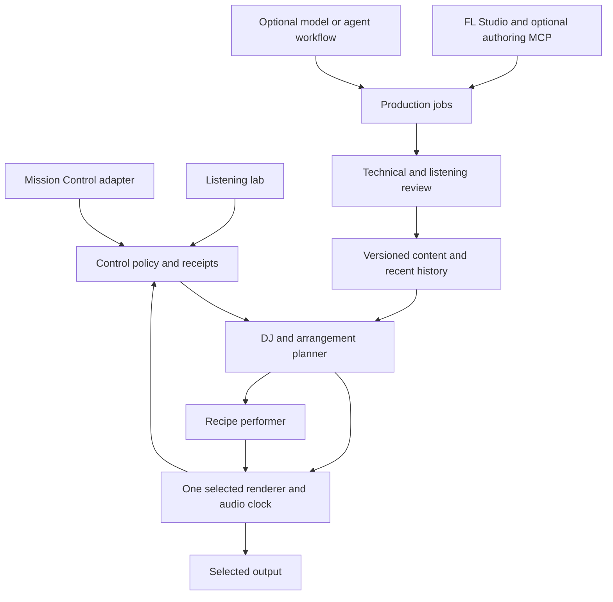

# Preliminary architecture

Document ID: `EM-D004`  
Status: revised proposal, 2026-11-03. No described runtime is implemented here.

## Current MVP sequence

The small **Codex/Claude → unified MCP → FL Studio authoring → procedural generator → DJ + standalone test app** is the first build. A Visual Basic or other graphical controller is optional. The FL authoring facade owns one real project writer and chooses tested scripting, GUI and external-render adapters; the playback clock and DJ remain independent. See [Unified FL agent control](FL_AGENT_CONTROL.md). Mission Control is a later caller of the same DJ requests. All earlier statements favoring MC integration inside the first proof are superseded by [First playable](FIRST_PLAYABLE.md).

## Main decision

Build the Mission Control soundtrack with **one renderer, one playback owner and one musical clock**. Keep authoring outside playback. Start the audible investigation with Web Audio; select the pilot renderer in EMF03 using actual evidence. This revises the initial presumption that a compiled native worker was required from the start. Native playback remains a candidate, not a rejected future.

Web Audio documents scheduled sample/synthesis playback. Browser lifecycle can suspend or discard pages, so background/persistence behavior must be tested rather than inferred. Choose native output when a required lifecycle, resource or audio behavior cannot be met, or when playback independent of a closed browser becomes required. Do not implement both production renderers before one works. [A1][A2]

[First playable](FIRST_PLAYABLE.md) defines the small proof and usable pilot. The full library, state, authoring and vocal documents describe the wider contract, not mandatory simultaneous implementation. Older authoring guidance describes a native deployment; its native-service wording applies when that renderer is selected, not as a separate prerequisite for the browser proof. This document owns the current backend decision.

## Ownership, not a fleet of services

Combine ordinary control, catalogue and selection work where practical. These boxes define responsibilities, not mandatory processes. A native audio worker is justified by the selected renderer; a Python service is an authoring/control candidate, not a compulsory dependency of a browser-only proof. Start with versioned files and a small bounded history; introduce SQLite when query/persistence needs justify it, without creating a second asset authority.

## Mission Control adapter and control service

The standalone test app is the first real consumer. Mission Control is integrated only after the independent music system works. Begin with explicit state controls, then a conservative optional adapter for verified aggregate activity signals. Do not read typing content or assume global native-app observation. Adapter signal freshness and smoothing are separate from the engine's musical dwell and scheduling. Music failure must leave work controls and messaging usable.

Control owns requested targets, revision checks, manual priority, hold and command receipts. The audio owner supplies audible state. The browser cannot infer completion from accepting a request. A thin single-listener façade can cover capabilities/state, intent, transport, hold and operation lookup without implementing every proposed MCP or multi-client feature first. It must retain the correctness semantics in [State/API](STATE_AND_CONTROL_API.md).

## DJ and arrangement planner

The initial DJ is deterministic: filter eligible sources, then select by state fit, recent identity/motif use, explicit preference and compatible route. Start with a few authored transitions. A general transition graph and coverage diagnostics develop in EMF13; neither all-pairs analysis nor model-based recommendation blocks the proof.

The planner operates over phrases/sections, prepares assets before committing and exposes why a transition waits. It can develop within a state, retain an identity across state changes, or plan a larger change. Dwell begins at audible entry. Give pending transitions a stated maximum-wait policy and a fallback; do not let musical patience become indefinite refusal. Manual stop/mute is not phrase-quantized.

When a target is unachievable, prefer a valid current continuation, prepared alternate, bridge or deliberate ending/fade. A non-loopable source cannot be continued indefinitely. A lost production job or missing next asset does not excuse arbitrary incompatible playback.

## Procedural performer and sound

A recipe defines groove, harmony, register, motifs, articulation, development and supported control envelopes; the palette supplies actually usable sounds. Use sample-based drums and expressive bass/harmony/melodic roles or suitable synthesis. Placeholder oscillators can test timing, but do not establish the quality result.

The performer shares the current tempo/meter/chord region and role plan with recordings. It cannot independently change global harmony or tempo during accompaniment. Review recipe/version/palette and bounded parameter behavior using selected and held-out seeds. Do not require a human to approve every possible future note sequence, and do not mistake sampled testing for proof all seeds sound good. Runtime checks constrain invalid notes, missing assets, excessive voices and unsafe plans; artistic quality still needs listening.

FL supplies editable compositions, stems, sections, transitions and eligible sounds. Exported audio carries a rendered sound; it does not install FL plugins in the player. Manual production and import are valid first routes. [A3]

## Shared musical timeline and handoff

Execution uses the renderer's authoritative audio timeline, mapped to sample positions and musical time. Wall clocks belong to logs. Represent sample rate, position, tempo/meter, transport status and engine generation. The first supported fixture can be constant-tempo 4/4; reject or explicitly fall back on unsupported meters/tempo maps, rather than silently misinterpreting them.

Each prepared plan binds source/recipe revisions, frame offsets, musical cues, harmony, role assignments, permitted variations, gain/filter automation, tails, prepare deadline and fallback. Account for decoder, resampler, stretch, synthesis/plugin and buffer latency/padding. Do not erase intentional pickups or slow attacks while compensating processing latency.

Example: a recorded section approaches its reviewed exit; procedural percussion enters; bass ownership transfers at a defined boundary; the lead finishes while a related harmonic passage continues; another recording is introduced at its approved entry. The small proof constrains this context deliberately. Pitched accompaniment of arbitrary unknown recordings is not initially supported.

Sample-aligned scheduling does not guarantee waveform phase coherence. Avoid unreviewed low-end or lead/vocal doubling; inspect actual combinations. Harmony tags are leads, not a substitute for the chord region actually being overlapped. [Library/transitions](LIBRARY_AND_TRANSITIONS.md) owns full directed route and cue semantics.

## Audio ownership and lifecycle

One audible session owns the selected output, including auditions. Additional tabs observe/control it rather than start another player. An audition explicitly transfers ownership from a checkpointed main session and leaves an explicit resume choice. Native playback can remain running without the control tab only under a chosen policy. Browser-only playback must report its actual page dependency. Remote control does not imply remote audio streaming.

Decode/preload outside the audio deadline; stream or bound residency for long content. Keep current and near-future samples resident with explicit limits. Do not put model calls, network access, filesystem writes, unbounded allocation or blocking control work in a real-time callback. Rate-limit production and analysis to protect ordinary development work. Native miniaudio is a documented playback/mixing candidate, not an adaptive music solution by itself. [A4]

An accepted command is queued intent; scheduled/started/completed events identify exact plan and engine revisions. A restart creates a new generation; stale plans cannot execute against it. Persist only confirmed checkpoints and reconcile unknown effects. Default crash recovery is stopped/resumable, not unexpected loud playback. Device loss should expose suspended state and only recover to an available selected device.

## Backend and processing decisions

| Area | First choice to investigate | Condition for more machinery |
| --- | --- | --- |
| Audition renderer | Web Audio, optional library for musical scheduling | Required background/device/resource behavior fails or independent native persistence is selected |
| Pilot renderer | One winner from EMF03, not two implementations | Another measured consumer requirement warrants a port |
| Catalogue | Versioned manifests plus small index/history | Query or persistence behavior justifies SQLite |
| Time/pitch | Authored compatible tempos and prepared variants | A required transition needs reviewed independent time stretching |
| Production | Existing FL workflow and editable scripts/MIDI | Repeated work justifies the bounded EMF15 bridge |
| Models/voices | Off during ordinary playback | A selected production job has a useful tested result and applicable terms |

Changing buffer playback speed resamples the sound; do not present that as independent pitch-preserving tempo adjustment. Dedicated stretching requires its own quality, latency and license decision. [A5]

## Persistence, trust and local access

Retain immutable media hashes, versioned recipes/manifests, cue/review scope, saved vibes, preferences and bounded listening/operation history. A saved seed/setup is not necessarily a byte-identical audio replay; exact recordings need explicit rendering. Cache keys include asset/recipe/DSP/model/configuration versions where relevant. Do not evict active-plan assets.

Treat packs, metadata and lyrics as data. A declarative recipe runs through allowed operations and limits; arbitrary uploaded Python, plugins or shell commands require a separate explicit trust/install decision. Production outputs are candidates and cannot silently become live assets. Private source material never uploads merely because a repo is public or an agent requests it.

Playback MCP and authoring MCP have separate scopes. A music-state caller cannot edit an FL project. Prefer a local stdio MCP transport for an agent-launched adapter where appropriate; HTTP deployments must follow the selected MCP specification, including origin handling and loopback binding. Authenticate ordinary local writes, constrain paths to registered roots and never treat localhost as automatic authority. [A6]

## Failure contract

| Failure | Required behavior |
| --- | --- |
| Missing/unprepared next source | Valid continuation/alternate/ending with a visible reason |
| Late model or FL job | Prepared playback continues independently; job outcome stays explicit |
| No allowed route | Approved bridge or deliberate fallback within policy, never invented compatibility |
| Noisy state input | Coalesce pending intent, respect manual hold, preserve safe started-transition behavior |
| Renderer crash/device loss | Visible stopped/suspended state; no stale-generation replay or duplicate owner |
| Load pressure | Bound voices/cache/jobs; report dropouts and degraded optional layers |
| Unknown FL effect | Inspect project/artifact evidence before retrying the original operation |
| Music subsystem failure | Mission Control work, messaging and navigation remain usable |

## Sources and limits

Primary sources checked 2026-11-03. They establish upstream mechanisms, not project performance or listening acceptance.

[A1]: https://developer.mozilla.org/en-US/docs/Web/API/Web_Audio_API/Advanced_techniques
[A2]: https://developer.chrome.com/docs/web-platform/page-lifecycle-api
[A3]: https://www.image-line.com/fl-studio-learning/fl-studio-online-manual/html/fformats_save_export.htm
[A4]: https://miniaud.io/docs/manual/index.html
[A5]: https://developer.mozilla.org/en-US/docs/Web/API/AudioBufferSourceNode/playbackRate
[A6]: https://github.com/modelcontextprotocol/modelcontextprotocol/blob/main/docs/specification/2026-07-28/basic/transports/streamable-http.mdx
