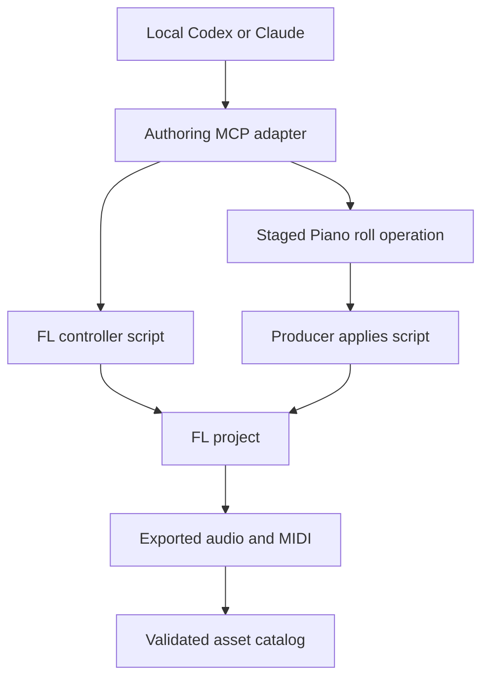

# FL Studio integration and MCP authoring bridge

**Status: design/research; not implemented/tested.** This repository does not currently ship an FL Studio controller, an MCP server, an installer, or a verified host integration. Source review date: **2026-11-03, America/Chicago**. The installed FL Studio version, activated edition, plugin entitlements, operating system, and audio configuration have not been verified.

## 1. Purpose and boundary

FL Studio is the production workshop for EUTONOS-Music: compose editable music, design sounds, record performances, refine mixes, and render assets. Codex or Claude should eventually help operate that workshop through a small, observable MCP interface. The result can be an original instrument, a song, a transition, a stem bundle, or material for a versioned recipe. This authoring path is useful for any genre supported by the actual instruments and production skills available.

The native playback service remains the authority for an EUTONOS-Music playback session. It consumes validated assets and recipes; it does not need FL Studio or a model request to finish the next beat. A browser can control that service and may later offer an optional playback backend. See [architecture](ARCHITECTURE.md), [library and transitions](LIBRARY_AND_TRANSITIONS.md), and [state and control API](STATE_AND_CONTROL_API.md).

The first useful integration is deliberately small: inspect a prepared project, change supported controls, write editable musical material, audition it, and register a verified render. Automatic plugin loading, arbitrary Playlist construction, and unattended audio export are separate capabilities that need evidence before being advertised.

## 2. What Image-Line documents

Image-Line provides distinct scripting surfaces inside FL Studio. Their existence does not establish a general remote DAW API or guarantee that a particular third-party bridge works.

| Surface | Documented capability | Consequence for this design |
| --- | --- | --- |
| [MIDI controller scripting](https://www.image-line.com/fl-studio-learning/fl-studio-online-manual/html/midi_scripting.htm) | Event-driven Python callbacks and modules for transport, channels, mixer, patterns, plugins, Playlist controls, and controller feedback. | Use a small controller adapter for supported controls. Probe functions on the actual host. |
| [Piano roll scripting](https://www.image-line.com/fl-studio-learning/fl-studio-online-manual/html/pianoroll_scripting_api.htm) | Python `.pyscript` files can create, inspect, change, and delete note/marker data through `flpianoroll`. Note timing uses ticks and score PPQ. | Keep note editing as a separate operation with an explicit target and application result. |
| [MIDI import](https://www.image-line.com/fl-studio-learning/fl-studio-online-manual/html/automation_midiimport.htm) | Import `.mid` note/control information into FL Studio. MIDI needs an instrument to produce audio. | Provide editable MIDI as a dependable interchange route when live control is unavailable. |
| [Audio export](https://www.image-line.com/fl-studio-learning/fl-studio-online-manual/html/fformats_save_export.htm) | FL Studio renders audio and can export individual Mixer tracks. | A render plan is useful even when a producer must perform the export. |

The online Piano roll reference specifically recommends checking the reference text installed with the application because it may be newer. Record the host's actual scripting API and feature observations in the compatibility report. Do not use an edition label, an API-stub package, or a successful MIDI-port open as evidence that all operations work.

Native scripts, Python packages in an external MCP process, and the DAW's plugin environment are different environments. Installing a Python package beside an MCP server does not install it into FL Studio. Similarly, sending a live MIDI note can audition a sound without creating persistent Piano roll notes.

## 3. Community MCP candidates

The following are research candidates, not dependencies selected for this repository. The linked snapshots identify what was reviewed. No candidate was installed, executed, benchmarked, or tested against a real FL Studio project here. The repositories identify themselves as MIT licensed; preserve their applicable notices if code is later adopted. An MCP implementation's license says nothing about rights to rendered sound content.

| Candidate and reviewed commit | Maintainer documentation | Source observations and decision |
| --- | --- | --- |
| [alansork/fl-studio-mcp](https://github.com/alansork/fl-studio-mcp/tree/a44cb483e30f9463f75a22771e0c57a0deff15c4) | JSON files plus a virtual MIDI trigger; transport, mixer, channels, diagnostics; a separate Piano roll queue applied from the FL menu. | Inspected mailbox, bridge, and Piano roll code. Useful small reference for a manual-apply workflow. Host compatibility and operation recovery still need testing. |
| [karl-andres/fl-studio-mcp](https://github.com/karl-andres/fl-studio-mcp/tree/202b7a28a4dc725350b68064d1be4e1eab852847) | Controller controls plus Piano roll scripts; automatic script triggering by platform keyboard shortcut. | Inspected Piano roll and trigger code. It writes requests, triggers a shortcut, and can read a state file. Useful note-editing reference; window focus, active target, freshness, and completion must be verified. |
| [Zierax/fl-studio-mcp](https://github.com/Zierax/fl-studio-mcp/tree/e97e4818a70970469fbde97f6cb73a402b2e3a40) | Broad controller API exposure, including generic/raw calls; documentation also describes limits around plugin loading, timeline placement, and rendering. | Reviewed README, limitations, tree, and part of the full-control module. Useful API-discovery reference. Broad access should not become the initial EUTONOS agent interface. |
| [rosasynthesiz/flstudio-mcp](https://github.com/rosasynthesiz/flstudio-mcp/tree/30ad1121fb511c7524d3b38261506a2e72a96595) | Bidirectional MIDI/daemon transport, a separately triggered note script, mixing tools, snapshots, readback, and rollback. | Inspected architecture, safety, and trigger code. Useful first evaluation candidate for observable writes. Its readback and rollback machinery exists in source; that is not proof of complete recovery or calibrated audio judgment on another host. |

### Important distinctions from source inspection

The [alansork mailbox implementation](https://github.com/alansork/fl-studio-mcp/blob/a44cb483e30f9463f75a22771e0c57a0deff15c4/src/bridge/ipc_handler.py) uses request IDs, a response timeout, atomic replacement, and a writer lock. Its Piano roll queue holds one pending action. The [application script](https://github.com/alansork/fl-studio-mcp/blob/a44cb483e30f9463f75a22771e0c57a0deff15c4/src/fl_scripts/MCP_PianoRoll.pyscript) edits the open score and renames the queue afterward. Therefore, our adapter must prevent pending-action replacement, stale-target edits, and uncertain replay; it cannot infer durable exactly-once application from those mechanisms alone.

The [karl-andres trigger](https://github.com/karl-andres/fl-studio-mcp/blob/202b7a28a4dc725350b68064d1be4e1eab852847/src/fl_studio_mcp/utils/fl_trigger.py) uses operating-system automation. Successful keystroke delivery is a different event from successful note application. A generic “triggered” message cannot substitute for a target-specific state readback.

The [rosasynthesiz safety layer](https://github.com/rosasynthesiz/flstudio-mcp/blob/30ad1121fb511c7524d3b38261506a2e72a96595/src/fl_studio_mcp/safety.py) contains snapshots, persisted change history, dry-run handling, and value verification/retry logic. Its [architecture](https://github.com/rosasynthesiz/flstudio-mcp/blob/30ad1121fb511c7524d3b38261506a2e72a96595/docs/architecture.md) reports controller filesystem restrictions and explains its MIDI transport choice. Treat that as the maintainer's environment evidence, not an official universal statement about every FL build.

A [Zierax issue](https://github.com/Zierax/fl-studio-mcp/issues/1) initially reported filesystem failures, but the reporter subsequently connected successfully and attributed the problem to MIDI settings. It is not evidence of a confirmed general incompatibility. The practical requirement is to test the exact controller transport, note-script route, and MIDI configuration together.

Several candidates use similar package or executable names. Select by repository, pinned revision, dependency lock, and inspected launch path—not by an unqualified package name or advertised tool count.

## 4. Proposed integration shape



This is a proposed topology. The initial adapter should support a manual Piano roll application gate; keyboard automation can be added as a separately tested capability. The gate exists because the note script must actually run in the intended FL context. It is not a request to repeatedly approve an already authorized musical task.

Keep the bridge local to the DAW machine. A cloud agent cannot reach a desktop process merely because both support MCP; a remote connection would require an explicit transport and access design. Model work stays outside the audio callback and outside FL's controller callbacks. A short controller callback should perform bounded control work and return.

Permit one writer lease per FL project session. Multiple agents may research, draft MIDI, or inspect cached artifacts concurrently, but Codex and Claude must not independently change the same project at once. Project changes by the producer invalidate affected prepared changes rather than being silently overwritten.

## 5. Capability discovery before setup claims

The first integration spike should use a disposable, saved project with a small instrument palette. Record:

1. FL version/build, operating system, activated edition, and scripting API version where observable.
2. Actual user-data folder, selected MIDI devices/ports, controller revision, note-script revision, and external server revision.
3. Loaded instrument/effect identity, available parameter metadata, and which controls accept verified writes.
4. Read-only state, transport, note staging, manual application, keyboard triggering, filesystem access, and MIDI round-trip results separately.
5. Audio output configuration and a known audition routing path, including how to stop playback and release auditioned notes.

Do not modify shared Python installation folders or bypass a host restriction to make a candidate appear compatible. If a route is unsupported, use the tested MIDI import/manual-export path while the narrower issue is investigated. Existing scripts and other controllers should remain identifiable during the spike so competing MIDI messages can be diagnosed.

## 6. Proposed MCP tool contract

**Every name and payload in this section is a proposal. None is an available EUTONOS-Music tool today.** The adapter should expose a compact, typed interface instead of forwarding arbitrary Python, raw module calls, shell commands, or unrestricted filesystem paths.

| Proposed tool | Input and scope | Result required |
| --- | --- | --- |
| `fl_bridge_inspect` | No musical mutation; optional expected host session. | Bridge/host versions, connection evidence, capabilities, target limitations, active writer lease. |
| `fl_scope_read` | Project session plus explicit transport, mixer, channel, plugin, or score scope. | Timestamped values, units, target identities, revision/digest, and unavailable fields. |
| `fl_change_prepare` | Desired absolute values or a bounded musical edit; expected scope digest. | Change ID, exact before/after plan, supported route, affected objects, recovery limitations. No DAW mutation. |
| `fl_change_apply` | Prepared change ID, matching digest, idempotency key, writer lease. | Operation ID and observed status; readback evidence when application completes. |
| `fl_notes_stage` | Target score, complete note batch, mode, timing units, current digest. | Immutable staged operation and application instructions, initially `pending_user_apply`. |
| `fl_operation_get` | Operation ID, or the original `project_session_id` + `idempotency_key`; exactly one selector. | Operation ID, current status, verified effects, errors, timestamps, and any required next action, including when the initial acknowledgment was lost. |
| `fl_operation_cancel` | Operation ID. | Whether dispatch was prevented; no claim to reverse an already applied edit. |
| `fl_export_plan` | Arrangement/selection, asset roles, render settings, destination within an allowed workspace. | Export instructions and expected files. Automatic rendering only if separately implemented and verified. |
| `fl_render_register` | Existing render paths, expected plan, source revision. | Decoded-file facts, hashes, missing/mismatched outputs, and proposed catalog entries. |

### Identity, units, and preconditions

An FL object index is not a permanent asset identity. Bind each operation to an adapter-generated `project_session_id`, host instance, target type/index/name, and a relevant state digest. Invalidate the session when the project changes or host restarts. If the adapter cannot reliably detect the project or target, advertise that limitation and require explicit selection verification for note application.

Use MIDI note numbers for portable note identity, with optional displayed names. Octave naming conventions differ. Define time as **quarter-note units**, not an ambiguous “beat.” Convert to FL ticks using the observed PPQ and disclose rounding. For a meter `n/d`, one bar contains `n * 4 / d` quarter notes. Do not force all genres into 4/4 or silently quantize expressive timing. Separate note velocity in `[0,1]`, MIDI interchange velocity, normalized plugin parameters, and real units such as dB or hertz.

An illustrative staged operation:

```json
{
  "contract_version": "draft-1",
  "operation_id": "op-example-001",
  "idempotency_key": "example-motif-revision-3",
  "project_session_id": "session-example",
  "target": {
    "kind": "piano_roll",
    "pattern_index": 2,
    "channel_index": 4,
    "expected_name": "motif",
    "before_digest": "sha256:illustrative-not-a-real-hash"
  },
  "action": "replace_managed_region",
  "region_quarters": [0, 16],
  "notes": [
    {"midi_note": 62, "start_quarters": 0, "duration_quarters": 1, "velocity": 0.68}
  ],
  "application_route": "manual_pyscript",
  "status": "pending_user_apply"
}
```

`replace_managed_region` is a design requirement, not a claim that a candidate already implements it. It must identify the notes it owns, specify treatment of notes crossing region boundaries, and preserve unrelated notes. If those guarantees cannot be established, use a new dedicated pattern and review its contents before transferring it.

### Validation and result shape

Require `project_session_id`, explicit target scope, an expected digest, and a valid writer lease for a mutation. `fl_change_apply` accepts a prepared change ID rather than an additional free-form instruction; changing the plan creates a new change ID. Reject unknown actions, non-finite numbers, negative note durations, ambiguous units, and unadvertised parameter ranges. The initial portable note contract accepts MIDI numbers 0–127; alternate tuning, per-note expression, and FL-specific note properties need explicit capability/schema extensions, not silent approximation.

The initial change allowlist should cover absolute transport state, bounded mixer/channel settings, discovered plugin parameters, and managed note/step data. Each capability advertises its target types, units, readback method, and recoverability. Do not treat arbitrary API discovery as permission to call everything discovered. Read responses should identify unavailable or truncated fields instead of substituting zero.

All operation results should use the same proposed envelope:

```json
{
  "contract_version": "draft-1",
  "operation_id": "op-example-001",
  "project_session_id": "session-example",
  "payload_digest": "sha256:illustrative-not-a-real-hash",
  "status": "applied_unverified",
  "effect_state": "observed_application_without_fresh_readback",
  "evidence": {
    "application_receipt": "receipt-example",
    "observed_scope_digest": null,
    "observed_values": null,
    "render_asset_ids": []
  },
  "error": null,
  "next_action": "Read the target score before declaring completion"
}
```

An error should contain a machine-readable code, message, affected scope, and whether effects may have occurred. Proposed codes include `UNSUPPORTED_CAPABILITY`, `TARGET_CHANGED`, `LEASE_CONFLICT`, `INVALID_PAYLOAD`, and `OUTCOME_UNKNOWN`. A failed response does not necessarily mean zero side effects. A `verified` result requires a fresh observation or an explicitly documented equivalent, tied to the same session and expected change.

Artifact operations accept paths only within the configured production workspace and return asset identities suitable for sharing instead of exposing workstation paths. Registration reads completed files and stages catalog records; it does not establish rights or musical acceptance. A prepare/register operation that persists a local record is not globally read-only merely because it leaves the DAW unchanged.

### Completion, replay, and timeouts

Use explicit states: `prepared`, `pending_user_apply`, `executing`, `applied_unverified`, `verified`, `rejected`, `failed`, `cancelled`, and `unknown`. Queue creation is not an applied edit. A rendered filename is not proof of a valid render. A setter's returned requested value is not independent readback.

Before dispatch, persist the mapping from the original `project_session_id` + `idempotency_key` to the operation ID and canonical payload hash in a durable journal outside FL. On replay, look up that journal entry **before stale-target, writer-lease, or expiry checks**. A matching payload retrieves the existing operation and its recorded outcome without redispatch; a different payload under the same key is a conflict. This lookup remains available for superseded sessions and expired leases. Only a new request proceeds through the current mutation preconditions. Correlate every response with an operation and session, reject stale responses, and serialize the complete dispatch/application cycle—not just writes to a mailbox file.

If a response is lost, recover through `fl_operation_get` using the caller-known original `project_session_id` + `idempotency_key`, even if the caller never received the operation ID. Return the journaled outcome when known; if application remains unresolved, report `unknown` and reconcile the actual target before another dispatch. Never automatically repeat an append, toggle, duplicate, or destructive clear after a timeout. Absolute value setters are preferable, but their target and current state still need verification. This design does not promise exactly-once effects across every crash boundary.

Initial timeout budgets are proposals: five seconds for ordinary state queries and ten seconds for small controller changes, adjustable after measurement. Staged user actions return immediately with an operation ID; they must not block a tool call while waiting for the producer. Large exports are jobs with progress and cancellation semantics, or explicit manual tasks. Expiry cancels only unapplied work. Once an edit has landed, recovery is a separate, scoped operation.

Store before/after evidence for reversible controls. A rollback should restore only a scope that has not subsequently changed. FL undo behavior, external plugin state, and a reopened project are different recovery mechanisms; do not present any of them as a universal transaction rollback.

## 7. Codex and Claude connection plan

Both clients document local MCP process configuration: [Codex MCP documentation](https://developers.openai.com/codex/mcp) and [Claude Code MCP documentation](https://code.claude.com/docs/en/mcp). These are configuration shapes for a future reviewed installation, **not runnable setup instructions for a server supplied here**:

```text
codex mcp add eutonos-fl -- <absolute-reviewed-server-command> <server-arguments>
claude mcp add --transport stdio eutonos-fl -- <absolute-reviewed-server-command> <server-arguments>
```

Replace placeholders with the selected adapter's actual command after the compatibility spike. Keep host paths, credentials, account details, and machine configuration out of public examples. Use the same adapter capability contract from either client, and test discovery plus one read before enabling writes. Configuration success and a real FL round trip are separate checks. See the [agent workflow](guides/AGENT_MUSIC_WORKFLOW.md) for session behavior.

MCP [tool annotations](https://blog.modelcontextprotocol.io/posts/2026-03-16-tool-annotations/) can describe read-only or repeatable intent, but they are hints. Enforce scopes, validation, leases, and replay handling in code rather than relying on annotation text.

## 8. Acceptance proposals

These are tests to implement during the spike, not passed results.

| Scenario | Evidence needed to accept the capability |
| --- | --- |
| Fresh connection | Actual host/version response; wrong port and absent host produce distinguishable failures. |
| Targeted control | A bounded fader/parameter change is independently read back; stepped values report the actual result. |
| Editable score | A small known phrase appears in the intended pattern/channel with expected pitch, timing, and velocity. |
| Wrong active target | A stale prepared edit is rejected or remains staged; no unrelated score changes. |
| Replay and loss | Recover a lost initial acknowledgment by session/key; same-payload replay retrieves the prior outcome despite stale mutation preconditions, and changed-payload reuse conflicts without adding duplicate notes. |
| Two clients | Only the writer lease holder mutates; the other client receives an explicit conflict. |
| Restart and cancellation | Old queued work cannot silently apply to a new project; cancellation reports whether dispatch occurred. |
| Render handoff | Files decode, match role/timing expectations, and are linked to the source project and export plan. |
| Audition and recovery | Producer can hear the intended change, stop playback, and restore the tested scope without losing later edits. |

Passing a stubbed Python test establishes behavior of the stubbed code. It does not establish DAW integration, plugin compatibility, musical quality, or export fidelity. Publish the tested version matrix, observations, and remaining manual steps with any eventual adapter release.

## 9. Decision to make after the spike

Evaluate the narrow manual-apply route and the MIDI/daemon alternative on the actual workstation. Choose or adapt a candidate only after state discovery, target identity, note completion, and recovery are demonstrated. Keep the adapter boundary independent of the selected project so a maintained implementation can replace it later. The [producer workflow](guides/FL_STUDIO_WORKFLOW.md) remains usable through MIDI import and manual export throughout this evaluation.
