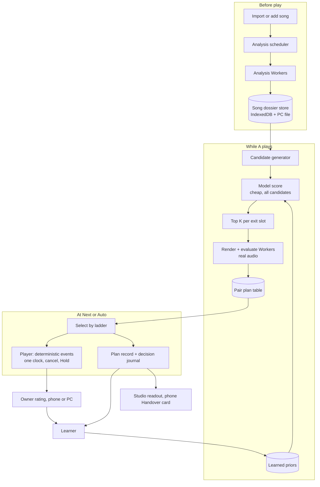

# Transition engine design

**Status: PROPOSAL (design only, 2026-11-16).** Nothing in this document is built. It was written against `main` at `e54f3a2` (EMF-S21 Part A and Part B merged). Another worker is changing `src/mix-analysis.ts`, `src/mix-planner.ts`, `web/transition-policy.ts` and `web/set-mode.ts` at the same time (structure analysis and cut avoidance), so some findings in section 1 may already be moving.

**Listening NOT TESTED.** Nothing here claims that any transition sounds good. Three kinds of statement are kept apart:

- **[repo]** read from the source or documents at `e54f3a2`.
- **[probe]** measured for this document with a throwaway script against the built evaluator, using synthetic songs. The script is not committed.
- **[judgment]** design opinion. DJs and the research disagree on several of these; the disagreements are named where they matter.

Related: [S21 planner](S21_TRANSITION_PLANNER.md), [S21 handoff](handoffs/EMF-S21-HANDOFF.md), [S19](S19_TRANSITIONS.md), [DJ transitions](DJ_TRANSITIONS.md), [set mode](S18_SET_MODE.md), [phone listening](S17_PHONE_LISTENING.md), [decks and analysis cache](S20_DECKS.md), [campaign](campaigns/EMF_INITIAL_INFRASTRUCTURE.md) (EMF-S21 to EMF-S24).

## Executive summary

The DJ falls back to clean cuts because of how it decides, more than because of what it knows about the songs.

1. **It decides once, in a hurry.** All analysis and planning starts when Next is pressed. It tries candidates one at a time in a fixed order and takes the first one that is not vetoed. It never compares several good options.
2. **Its own checker rejects the safety net.** The echo fallback fails the loudness check at every tempo gap, because the check expects a plain crossfade. Cuts and echoes into a faster song fail a beat-alignment check, although they make no beat-alignment promise. One failed check removes the echo fallback at every bar, and the cut is next in line.
3. **Several softer recipes are closed by gates that do not belong to them.** Filter sweeps, loop extension and tempo ramps are refused for about five in six key pairs.

The proposal is a transition engine with four habits:

- **Analyse before play.** Every song gets a saved "dossier" when it is added, and the whole queue is analysed in the background.
- **Search while the current song plays.** Generate thousands of candidates, score them cheaply from the dossiers, then render and check the best few in a Worker.
- **Judge each recipe on what it promises.**
- **Degrade through a ladder** (verified plan, quick plan, safe dissolve, good cut) and say which rung was used.

Ratings then adjust the engine's preferences, with a safety floor. Eight increments are proposed. The first removes the false rejections; the second builds the dossier and the background scheduler.

## 1. Why the current pipeline lands on cuts

### 1.1 The decision chain [repo]

| Step | Where | What happens |
| --- | --- | --- |
| 1. Request | `SmallPlayer.scheduleMixTo` (`src/player.ts`) | Next (4 or 8 bars) or Auto (16, 32 or 64 bars after the song entered) asks for a handover. All work below starts now. |
| 2. Analyse A | `MixAnalysisCache.analyze` (`src/mix-transition.ts`) | One 60 s window of A around the target bar. |
| 3. Analyse B | `incomingAnalysis` (`src/player.ts`) | B's whole song in 60 s windows, raced against `SET_SONG_ANALYSIS_DEADLINE_MS` (6 s). On a miss B has no analysis for this request. |
| 4. Recipe order | `tempoGapPolicy` (`web/transition-policy.ts`) | A fixed list per tempo band. Rhythm recipes are removed if the grid is not trusted. |
| 5. Candidates | `chooseSetTransition` (`src/mix-transition.ts`) | For each recipe in order, a few variants (two exit bars, up to three choreographies). **Returns the first variant the planner accepts.** |
| 6. Planner | `planBlend`, `styledBlend`, `alternatePlans` (`src/mix-planner.ts`) | Evidence gates, cue filters, one plan per call. |
| 7. Prepare | `prepareSetIncoming`, `prepareOutgoingLoop` | Time-stretch render of B's entry window (and A's ramp for the dual ramp). |
| 8. Pre-check | `checkSelectedMix` → `browserMixPrecheck` → `evaluateTransition` | Offline render and measure. PASS or WARN schedules. FAIL excludes this candidate and loops to step 5. |
| 9. Retry bound | `SET_CANDIDATE_ATTEMPTS = 5` | The fifth FAIL refuses the handover; the playing song continues. |
| 10. Route-free | `planRouteFreeTransition` | With no analysed plan: crossfade (gap up to 8%), then the filtered echo reset, then the cut. |
| 11. Record | `fallbackAfterFailedPrecheck` | A cut reached after failed checks is labelled as a fallback. |

### 1.2 Where it gives up early, or applies the wrong gate

| # | Finding | Evidence |
| --- | --- | --- |
| G1 | **The echo reset cannot pass its own check.** The loudness check compares the mix with a straight A-to-B interpolation over the whole window. The echo reset high-passes A and closes its dry signal before B enters, so it dips about 3.3 LU against that target and FAILs (limit 3 LU). | [probe] FAIL at 0%, 8%, 12% and 22.3% gaps; WARN (1.9 LU) only for 122→100. [repo] The S21 handoff reports the same 3.3 LU failure on the Studio fixture. |
| G2 | **Native-tempo entries are judged on beat phase.** For `cut` and `echo-out` the evaluator compares B's beats with A's grid for 1.01 of A's beat periods after the entry. If B is faster, B's second beat falls inside that window, with an error of `1 − bpmA/bpmB`. That is above the 0.10 fail limit for any gap over about 11%. These recipes do not beat-match. | [repo] `beatPhase` in `web/mix-evaluator.ts`. [probe] 100→122.3: cut FAIL 0.182, echo FAIL 0.182. 100→112: FAIL 0.107. 122.3→100: one beat judged, PASS. |
| G3 | **One failed check removes the echo reset everywhere.** `transitionSignature` returns the bare recipe name for route-free plans, so the exclusion covers every bar and there is no second set of parameters to try. The next candidate is the cut. | [repo] `transitionSignature`, `planRouteFreeTransition` (`exclude`). |
| G4 | **A weak or distant key closes four recipes that it should not.** `planBlend` refuses a harmonically limited pair unless a choreography is supplied. `chooseSetTransition` supplies one only for blend, meet-in-the-middle and dual ramp. Filter sweep, loudness match, loop extend and tempo ramp are therefore refused whenever the keys are not same, relative or adjacent-fifth (4 of 24 keys), or key confidence is under 0.55. A filter sweep is a tool DJs use precisely when keys do not fit. | [repo] `planBlend` ("A weak or distant key needs a mid-limited choreography"), `usesChoreo` in `chooseSetTransition`. |
| G5 | **Only two exit bars are considered.** Exits are the next requested boundary and the one after it. If the analysis has no exit cue within an eighth of a bar of those two frames, every analysed recipe is skipped. The exit is set by a bar counter, not by the song's structure. | [repo] `boundaries`, `onBoundary` in `chooseSetTransition`. |
| G6 | **First acceptable, not best.** Candidates are tried in a fixed order and the first that plans and is not vetoed is scheduled. The evaluator only vetoes. `chooseEvaluatedMix` can rank, but only the pair and offline paths use it. | [repo] |
| G7 | **Echo-out, cut and brake demand full rhythm evidence on both songs.** `alternatePlans` requires tempo confidence 0.65, ambiguity at most 0.5, beat confidence 0.6 and downbeat confidence 0.65 for A and B, although B enters at its own tempo. It then keeps at most three exits, three entries and two plans. | [repo] `alternatePlans`. |
| G8 | **The tempo ramp only exists in two narrow gap ranges.** It needs the pitch change to land within 0.2 semitone of a whole semitone, and it is refused under 8%. That leaves gaps of about 11.0–13.6% and 17.6–20.3%. A 22.3% gap is 3.49 semitones: refused. | [repo] `styledBlend`, `planBlend`; arithmetic. |
| G9 | **The brake needs headroom most masters do not have.** `nativeMotionPeak` requires the whole song's sample peak to be at or under −1 dBFS on both songs. It is also removed by the grid gate, although a brake deliberately leaves the grid. | [repo]. Whether the owner's songs exceed −1 dBFS was not measured. |
| G10 | **The 6 s deadline throws B's analysis away for this request.** B then enters at the start of its requested grid through the route-free path only. | [repo]; also listed as a known gap in the S21 planner document. |
| G11 | **An `unavailable` pre-check aborts.** A worker timeout (8 s) or a window over 4,000,000 samples stops the handover instead of trying the next candidate. | [repo] `checkSelectedMix`; S21 known limit. |
| G12 | **Auto's lead time is not used.** Auto asks for a handover 16 to 64 bars ahead (roughly 30 to 170 s at these tempos), but the plan is chosen in the same single pass and then frozen. | [repo] `runAuto` in `web/studio.ts`. |
| G13 | **After a late or failed render, every stretched recipe is switched off** for the rest of the request (`choose(false)`). | [repo] |
| G14 | **Vocal spans are never measured.** `vocalSpans` is only ever supplied by a caller. The cue code states that vocal activity is unknown. | [repo] |

### 1.3 The 22.3% case

A 22.3% gap is in the `bridge` band. The dual ramp cannot reach it (its limit is about 17.4%). The order is echo-out, tempo ramp, brake, echo reset, cut.

1. **Echo-out** is refused at planning unless both songs pass G7 and an exit cue with low density sits on one of two bars (G5).
2. **Tempo ramp** is refused by G8, and usually by G4.
3. **Brake** is refused by G9 or G7.
4. **Echo reset** plans, then FAILs the pre-check (G1; also G2 if B is the faster song). This is the one failed pre-check.
5. G3 removes the echo reset at every bar. The **cut** is next.

This matches the owner's report. Which metric failed in the live run is not known from the repository. If B was the faster song and both grids were measured, the cut itself would also fail G2 and Next would be refused, so the live run had either a slower B or an unjudged grid. [judgment from reading; not reproduced on the owner's songs]

**The top three causes:** G1 with G3 (the safety net is rejected by a check that does not fit it, then removed wholesale), G4 (soft recipes closed by a key gate), and G6 with G12 (one hurried first-fit pass, no search).

## 2. Engine architecture

### 2.1 Overview



### 2.2 Parts and their state today

| Part | Exists [repo] | Partial | New |
| --- | --- | --- | --- |
| (a) Analysis | Tempo, grid, downbeat, global key, per-bar cue features, energy curve, whole-song windows, tempo ratio repair, IndexedDB cache | Structure is boundary strength only; no labels. Run on demand, not before play | Song dossier, sections, low-band occupancy, lead presence, per-bar loudness, edges, persistent PC store, scheduler |
| (b) Candidates | Ten recipes, five EQ choreographies, seeded explore | One candidate per recipe and variant; two exit bars | Parametric generator over exit and entry sections, durations, tempo strategies and effects |
| (c) Search | Retry loop of 5 | `chooseEvaluatedMix` ranks in pair mode | Anytime search, pair plan table, budget by lead time |
| (d) Evaluator | `transition-evaluator@1`, `mix-evaluation-thresholds@1`, `transition-safety@1`, Worker pre-check | Beat phase models ramps; loudness target is one shape | Recipe claims, new measures (section 2.6) |
| (e) Execution | One clock, one master, cancel, Hold, deck mixer, native join | — | Unchanged. The engine only supplies a plan |
| (f) Learning | Ratings file, tags, report | Explore draws parameters but nothing learns | Priors, bandit with safety floor, A/B audition |
| (g) Explainability | `em.transition-plan.v1`, `why`, `rejected`, phone Handover card | Only rated plans are kept durably | Decision journal for every handover, confidence and ladder rung, replay |

### 2.3 (a) Analysis: the song dossier

**Principle: songs are analysed before play.** Analysis runs when a song is added to a library, set or pack, and for the whole queue at startup. The result is saved. At transition time the engine reads dossiers and does only pair work: candidate search, render and evaluation.

**Schema sketch** (`em.song-dossier.v1`). Times are in seconds and bars, not context frames, so one dossier serves any AudioContext sample rate. A bound view converts to frames for the planner.

```ts
interface SongDossier {
  readonly version: 'em.song-dossier.v1';
  readonly key: {readonly sha256: string; readonly analysis: string;      // e.g. 'song-dossier@1+mix-analysis-v5'
    readonly tempoHint: number | null; readonly downbeatHintSeconds: number | null};
  readonly source: {readonly sampleRate: number; readonly frames: number; readonly channels: 1 | 2; readonly seconds: number};
  readonly tempo: {readonly bpm: number | null; readonly confidence: number; readonly ambiguity: number;
    readonly alternatives: readonly {bpm: number; ratio: string; support: number}[];   // octave and 3:2 rivals
    readonly driftBpm: number; readonly resolvedBy: string};
  readonly grid: {readonly beatSeconds: readonly number[]; readonly downbeatIndexes: readonly number[];
    readonly beatConfidence: number; readonly downbeatConfidence: number;
    readonly barPhaseSupport: readonly [number, number, number, number];           // evidence for each of the 4 bar phases
    readonly source: 'audio' | 'requested-origin' | 'audio+requested'};
  readonly tonal: {readonly key: string | null; readonly confidence: number; readonly alternatives: readonly string[];
    readonly tuningCents: number | null};
  readonly loudness: {readonly integratedLufs: number | null; readonly truePeakDbtp: number | null; readonly samplePeak: number};
  readonly bars: readonly BarFeatures[];
  readonly sections: readonly SongSection[];
  readonly edges: {readonly leadInSilenceSeconds: number; readonly fadeOutStartSeconds: number | null; readonly tailSilenceSeconds: number};
  readonly cues: {readonly entries: readonly DossierCue[]; readonly exits: readonly DossierCue[]};
  readonly quality: {readonly flags: readonly string[]; readonly coverage: number};  // 'tempo-ambiguous', 'downbeat-weak', 'partial', ...
  readonly cost: {readonly decodeMs: number; readonly analysisMs: number; readonly at: string};
  readonly limitations: readonly string[];
}
interface BarFeatures {
  readonly bar: number; readonly startSeconds: number;
  readonly lufs: number | null; readonly rms: number;
  readonly lowShare: number;        // 20-160 Hz energy share, the LR4 low band
  readonly kickOnsets: number; readonly bassSustain: number;
  readonly midFlux: number; readonly highFlux: number; readonly centroidHz: number;
  readonly percussiveShare: number; readonly leadPresence: number | null;   // 0..1 likelihood, never "vocal detected"
  readonly chroma: readonly number[]; readonly loopability: number;
}
interface SongSection {
  readonly startBar: number; readonly endBar: number;
  readonly kind: 'lead-in' | 'intro' | 'build' | 'main' | 'breakdown' | 'outro' | 'unknown';
  readonly energy: number; readonly drums: 'yes' | 'no' | 'unsure'; readonly lead: number;
  readonly localKey: string | null; readonly confidence: number;
}
```

Section `kind` is a description of energy and density relative to the song. It is not a verse or chorus label. The concurrent structure-analysis work owns how sections are found; this design only fixes the shape the engine reads.

**Where it is stored**

| Store | Holds | Why |
| --- | --- | --- |
| IndexedDB in the DJ page (exists) | Today: per-window `MixAnalysis` and waveform, keyed by sha256, analysis version, level version, sample rate, window and tempo hint. 64 records, 16 MiB. [repo] | Fast reload in a normal browser profile. Add a dossier object store beside it. 64 per-window records are too few for larger sets, so the dossier is one record per song. |
| PC file store through the relay (new) | `local/song-dossiers/<sha256>.<analysis>.json`, one file per song and version | `npm run phone:host` opens the DJ in a throwaway browser profile, so IndexedDB is empty on every run. [repo] The file store survives. |
| Memory | Bound views and decoded audio for the playing and next songs only | The existing retention rule keeps one extra decoded song. |

Privacy rules for the file store: local only, under the git-ignored `/local/`, no audio, no absolute paths, song ids and hashes only, the same symlink and size refusals as `scripts/transition-feedback-file.ts`. The endpoints belong to the relay's loopback DJ side (`/api/dj/...`), never the phone side. `scripts/serve.ts` stays unchanged.

**Invalidation and versioning**

- The key is audio sha256 + analysis version + tempo hint. A dossier whose key does not match is never used for planning.
- When analysis code changes, the version string changes. Old dossiers stay on disk. They may still feed the display (labelled "older analysis"), but the planner treats the song as not yet analysed.
- Re-analysis is lazy and in the background, in scheduler priority order. It never blocks playback or Next.
- A dossier carries a payload digest, as the IndexedDB cache does today. A bad record is deleted and the song is re-analysed.
- Pair plan tables are keyed by both dossier keys plus the engine, evaluator and policy versions, so they fall away automatically.

**Background analysis scheduler**

| Priority | Song | Reason |
| --- | --- | --- |
| P0 | Now playing | Exits are needed first. |
| P1 | Next in the queue, or the owner's set-next choice | The pair search needs it. |
| P2 | The rest of the queue, in order | Later pairs. |
| P3 | The rest of the set or library | Any song can follow any song. |

- **Workers.** Pool size `clamp(hardwareConcurrency − 2, 1, 3)`. One core is left for the page and audio, one for the phone stream encoder. [judgment; measure on the owner's PC]
- **Memory.** A decoded 3-minute stereo song is about 60 MB as float32. Background analysis decodes one song at a time, analyses it, and releases the audio. Only the dossier is kept.
- **Yielding.** Background jobs pause while a handover is being prepared or mixed, and whenever a pair render is waiting. Analysis never runs on the audio thread.
- **Idle use.** At startup the whole queue is scheduled. When stopped or paused, the pool may use all its Workers.
- **Readout.** Studio and the phone status show one line, for example "Analysed 7/9 · next ready (3 checked plans)". The phone gets two optional status fields; an older phone page ignores them, as with the existing optional fields.
- **A song not yet analysed when Next is pressed** goes down the ladder in section 4.3. The song is promoted to P0 at once. Next is never refused for this reason.

**Import triggers.** The analysis code is plain TypeScript and already runs in Node. The Node intake commands (S06 `import`, S09 FL import, S16 `import:rated`, S18 set intake) can therefore write a dossier to the file store when they add a song. The browser scheduler then only fills gaps. One risk: a browser may decode to a different sample rate than the file. The dossier stores seconds for that reason, and the bound view must be validated against the decoded length before use. [judgment; the frame-exact reuse rule in the existing cache shows this matters]

**Cheap versus expensive**

| Tier | Work | When |
| --- | --- | --- |
| Cheap | Loudness, peaks, edges, per-bar band energies, centroid, onset counts (one pass over the audio) | Always, first |
| Medium | Tempo, grid, downbeat, chroma, key, sections (today's analysis, per window) | Always |
| Expensive | Harmonic and percussive separation, lead presence, loopability | Background, after every song has the first two tiers |

The dossier records which tiers are complete, so the engine can plan with a partial dossier and say so.

### 2.4 (b) Candidate generation

A candidate is a point in a parameter space, not a recipe name.

```ts
interface CandidateSpec {
  readonly id: string;                         // hash of the canonical content
  readonly family: RecipeFamily;               // 'blend' | 'dual-ramp' | 'filter-dissolve' | 'echo-dissolve' | 'bass-handover' |
                                               // 'loop-bridge' | 'beatless-bridge' | 'brake' | 'good-cut' | ...
  readonly exit: {readonly bar: number; readonly section: SongSection['kind']};
  readonly entry: {readonly bar: number; readonly section: SongSection['kind']};
  readonly overlapBars: number;                // 0, 1, 2, 4, 8, 16, 32
  readonly tempo: {readonly strategy: TempoStrategy; readonly meetBpm: number | null; readonly returnBars: number};
  readonly eq: ChoreographyParams | null;      // existing eq-choreography@1 parameters
  readonly fx: {readonly kind: 'none' | 'echo' | 'filter' | 'reverb-tail'; readonly bars: number; readonly amount: number};
  readonly level: {readonly toGainDb: number};
  readonly claims: RecipeClaims;               // what the evaluator may hold it to (section 2.6)
}
```

- **Exits:** every phrase or section boundary of A from the earliest feasible bar to the end, not two bars.
- **Entries:** B's section starts and phrase boundaries, with the existing skip cost. Not always the start.
- **Hard constraints prune first:** audio must exist for the whole plan; stretch within the time-stretch limits; a beat-locked candidate needs trusted grids on both songs; an overlap that sustains harmony needs compatible local keys or a mid-limited choreography.
- **Explore** draws from the same space with a seed, as today.

The space is large (order of 10⁴ to 10⁵ points for one pair [judgment, by multiplication]). That is fine, because the next stage is cheap.

### 2.5 (c) Scoring and search

**Stage 1: model score.** Arithmetic over the two dossiers. No audio is touched, so every candidate can be scored in well under a second [judgment; to be measured].

| Term | Reads |
| --- | --- |
| Structural fit | Exit at a section end, entry at a section start, phrase alignment |
| Energy continuity | Per-bar loudness of A's last bars and B's first bars |
| Low-band clash | Both songs' `lowShare` and `kickOnsets` across the overlap, under the candidate's band gains |
| Lead overlap | Both songs' `leadPresence` across the overlap |
| Harmonic fit | Local chroma of the overlapping bars, not only the global key |
| Tempo strain | Stretch per deck, ramp length |
| Grid trust | Confidence, multiplied by whether the candidate claims beat lock |
| Skip cost | Existing `entry-skip@1` |
| Variety | Penalty for repeating the previous handover's family |
| Learned prior | Section 2.8, bounded |

**Why pre-analysis narrows the search.** Section, energy and tempo data remove most of the space before anything is rendered. A pair with a 22% gap has no beat-locked candidates at all. A dense B entry removes long dissolves. An A exit with a lead line removes echo tails. A breakdown with no drums in either song makes a long overlap possible at any tempo gap, and the generator can only see that from the dossier. Rendering is then spent on a few dozen plausible candidates instead of on a fixed list of five.

**Stage 2: render and evaluate the top K.** For each exit slot, the best few model-scored candidates are rendered offline in a Worker on the real audio and judged by the evaluator. Results go into the pair plan table.

```ts
interface PairPlanTable {
  readonly pair: {readonly fromSha256: string; readonly toSha256: string; readonly versions: Record<string, string>};
  readonly slots: readonly {readonly exitBar: number; readonly ranked: readonly ScoredCandidate[]}[];
  readonly searched: {readonly generated: number; readonly modelScored: number; readonly rendered: number; readonly ms: number};
  readonly complete: boolean;                 // false while the search is still improving it
}
interface ScoredCandidate {
  readonly spec: CandidateSpec;
  readonly model: {readonly score: number; readonly terms: Record<string, number>; readonly prior: number};
  readonly status: 'modelled' | 'checked-pass' | 'checked-warn' | 'rejected';
  readonly evaluation?: TransitionEvaluation; readonly reason?: string;
}
```

**Anytime rules**

- The search runs from the moment the pair is known and keeps improving the table until the handover is committed.
- It always holds a best-so-far answer. Slots nearest in time are filled first.
- It stops when the budget ends, when K candidates per slot have been checked, or when the next candidates' model scores are far below the best checked one.
- **It never returns a cut while budget remains** and an unrendered non-cut candidate exists.
- The final score of a checked candidate is the model score plus evaluator penalties. Passing the evaluator is a floor, not the ranking.
- Rendered buffers of the best one or two candidates in the nearest slots are kept, so Next can schedule without rendering again. A B entry window of 40 s stereo is about 14 MB.
- The search is cancellable. Changing the next song (set-next, reorder) cancels it and starts the new pair; both dossiers already exist, so only pair work is repeated.

**Pair precomputation ahead.** For the playing song and the next song: full search with rendering. For the next two queue pairs: model scoring only, no decode. They get rendering when they become the current pair.

### 2.6 (d) Evaluator

The existing evaluator stays the single judge: `renderTransition`, `measureTransition`, `judgeTransition`, `judgeSafety`. Two changes are proposed.

**Recipe claims.** Each candidate states what it promises, and the evaluator judges only that, plus defects that are never intended.

```ts
interface RecipeClaims {
  readonly beatLocked: boolean;                          // false: only the entry downbeat is judged
  readonly loudnessShape: 'crossfade' | 'dip' | 'step';  // 'dip' declares where and how deep, like declaredGaps today
  readonly declaredDips: readonly {startFrame: number; endFrame: number; maxDropLu: number}[];
  readonly bass: 'swap' | 'gap' | 'handoff-at-entry';
  readonly sustainedHarmonyBars: number;
}
```

- Always judged: clipping, true peak, sample jumps (clicks), unintended silence, low-band rise.
- Judged only when claimed: beat phase across the overlap, boundary flux, bass hole, loudness against a crossfade target.
- This fixes G1 and G2 without loosening any limit for the recipes those limits were written for.

`mix-evaluation-thresholds@1` is frozen, so this is a new versioned set (`@2`) that is recorded beside `@1`. Both verdicts are logged during the changeover. Whether `@2` may gate live handovers is an owner decision (section 11).

**Additional measures, ranked** [judgment]

| Measure | Method | Use |
| --- | --- | --- |
| Loudness continuity | Short-term LUFS of 3 s before S and 3 s after E, and the largest step between adjacent 1 s windows | Catches volume jumps on cuts and echoes, which today's interpolation target cannot express |
| Low-band masking | Per 50 ms cell: low-band energy of A's and B's processed stems, both above a floor at once, summed over the overlap | "Two basses at once", separate from the existing rise rule |
| Beat phase after ramps | Onsets detected in the rendered mix against the predicted grid, as a cross-check of the mapped analysis grids | Today's phase uses analysis grids only, never the rendered audio [repo] |
| Lead overlap | `leadPresence` of both songs across the overlap, weighted by mid-band gain | Proxy for vocal clash; unreliable without stems |
| Key clash | Chroma of the rendered overlap: energy on semitone and tritone neighbours of each song's strong pitch classes | Local, not global-key, dissonance |
| Direct-to-split crossfade | Model the 64 ms band-split handover | A known unmodelled spot [repo] |

Every new measure starts as **logged only**. It becomes a gate only after ratings show that it separates liked from disliked handovers.

### 2.7 (e) Execution

Unchanged in principle. The engine returns one plan; the player schedules it with `scheduleMixStart` and `transitionMixOut` on the one audio clock. Preparation happens before commit. Cancel, Stop, Hold and reorder invalidate pending work exactly as now. The engine adds no timers that start music. A plan from the table is re-validated against the clock, the playing voice and A's current gain before it is committed; a stale plan is dropped and the ladder is used.

### 2.8 (f) Learning

**Goal:** move preferences inside the space the evaluator already allows. Learning never overrides a failed safety check.

- **Arms** are coarse parameter choices: family, choreography, overlap bucket, entry kind, tempo strategy.
- **Context** is a few buckets: tempo-gap band, A exit section kind, B entry section kind, key relation, energy direction (up, level, down).
- **Model:** a hierarchical Beta model of "liked" per arm, shrunk towards the arm's all-context mean and then towards its family. Ratings map to love 1, like 0.75, ok 0.4, dislike 0. With few ratings the estimate stays near the prior. [judgment; the mapping is an owner decision]
- **Selection:** Thompson sampling among candidates that passed the evaluator. The sampled value enters the score as a bounded term (at most ±20% of the score range), so analysis and evaluation still dominate.
- **Safety floor:** explore only among checked-pass candidates; never a cut as an explore draw; an explore draw is at most one handover in four by default, with an owner switch.
- **Tags** adjust specific parameters, not the arm: "too long" shifts the overlap preference, "volume jump" and "bass clash" become labelled examples for evaluator calibration.
- **Output:** a versioned snapshot `em.transition-prior.v1` in `/local/`, rebuilt deterministically from the ratings file and the decision journal. Deleting it returns the engine to defaults.

### 2.9 (g) Explainability

- **Plan record v2** (`em.transition-plan.v2`): everything in v1, plus the candidate parameters, score terms, evaluator readout, ladder rung, confidence, search counts and budget used. v1 records stay readable.
- **Decision journal:** `local/transition-log/decisions.jsonl`, one line per handover, rated or not, with the top candidates and their scores. Written by the relay like the ratings file.
- **Rejected list:** as now, each with a plain reason.
- **Phone Handover card:** one sentence and one badge.

| Badge | Meaning |
| --- | --- |
| Checked | Rendered and judged before it played |
| Modelled | Chosen from analysis; not rendered in time |
| Fallback | A lower ladder rung; the card says which and why |
| Unsure | Checked, but the engine names a doubt (see below) |

**How the engine says it is unsure.** A plan carries `unsure: string[]`. Reasons include: a grid that is requested rather than measured; tempo ambiguity above the gate; the top two candidates within a small score margin; a context with no ratings; a partial dossier; an evaluator warning. The Studio readout lists them. The owner listens only at build points, so the journal is the record of what happened in between.

## 3. What else to fold into analysis

Ranked by expected effect on perceived quality against cost. All run in a Worker without ML models. The ranking is judgment; none of it has been listened to.

| Rank | Feature | Method | Cost | Engine use |
| --- | --- | --- | --- | --- |
| 1 | **Section map with energy level** | Bar-synchronous features, checkerboard novelty (exists as `cueMeasurements`), then segment and describe by relative loudness and density | Low on top of existing features | Exit at section ends, enter at section starts, match energy, drive sweetening later |
| 2 | **Low-band occupancy per bar** (kick and bass) | LR4 low band (20–160 Hz) energy share and onset count per bar; sustained versus percussive by envelope shape | Low; `lowOnsets` and `lowRms` already exist | Time the bass swap, predict mud, find bars with no bass for exits |
| 3 | **Drum-less and breakdown detection, edges** | Per-bar percussive share and kick count below a song-relative floor; leading silence and fade-out by envelope | Low | Beatless overlaps at any tempo gap, clean exits, never start in silence |
| 4 | **Loudness per bar and section** | BS.1770 K-weighting (exists) per bar, short-term | Low | Level match at the real exit and entry, loudness continuity, good cuts |
| 5 | **Downbeat reliability and half or double ambiguity** | Support for each of the four bar phases; octave and 3:2 rivals with support (extends `tempo-relation@1`); per-window stability | Low to medium | Gate per claim instead of per song; allow 2:1 pairing; mark songs for a manual check |
| 6 | **Lead presence** (vocal or lead line likelihood) | Median-filter harmonic and percussive separation on an STFT, then mid-band (300–3400 Hz) harmonic energy and pitch continuity per bar | Medium to high | Avoid overlapping two leads, avoid cutting mid-phrase |
| 7 | **Local key and chroma per section** | Average per-bar chroma (exists) over each section; tuning offset from peak positions | Low | Harmonic fit of the bars that actually overlap |
| 8 | **Brightness curve** | Spectral centroid and high-band share per bar | Low with the STFT | Filter sweep direction and cutoff targets, tone-dissolve matching |
| 9 | **Loopability** | Similarity of consecutive bars and seam continuity for 1, 2 and 4-bar loops | Medium | Loop extend, drum-loop bridge |
| 10 | **Transient density** | Onset rate per bar (`midFlux`, `highFlux` exist) | Free | Echo and reverb tails suit sparse bars |

Honest limits:

- **Lead presence without stems is weak.** Synth leads, guitars and vocals look alike. It must be reported as a likelihood and never as "vocal detected". If EMS-S05 adds stems, it replaces this feature. The generator's own metadata (instrumental or not, lyric timing) may be a better hint than any signal method, and should be treated as a hint, not as measured truth.
- **Section kinds are relative descriptions**, not musical form.
- **4/4 at 90–128 BPM is assumed**, as today.
- **Research and practice disagree** on how much harmonic mixing matters next to phrasing and energy. This ranking puts structure and bass first. That is a judgment.

## 4. Time budgeting

### 4.1 How much lead time there really is [repo]

| Situation | Lead time |
| --- | --- |
| Auto | The request is made as the song enters, for 16, 32 or 64 bars later: about 30 to 170 s at 90–128 BPM |
| Next, queue known | The pair is known from the moment the current song starts: up to the whole song (about 3 minutes) |
| Next pressed | The handover lands 4 or 8 bars on: about 8 to 21 s, minus a 2 s preparation allowance |
| Next after set-next or reorder | Only the time since the change |
| First song of a session | None for analysis unless dossiers are already saved |

Today all of the work is done inside the third row. With dossiers saved and the pair search started when a song enters, the third row only has to select and schedule.

### 4.2 What is precomputed

- **Per song, saved:** the dossier.
- **Per pair, in memory:** the plan table for current → next, with rendered audio for the best candidates in the nearest slots.
- **Per pair, ahead:** model scores for the next two pairs.
- **Recomputed** when the next song changes, when A's gain changes, or when a version changes.

### 4.3 The ladder

When Next or Auto asks for a handover, the engine takes the highest rung available. It records the rung.

| Rung | Plan | Needs | Badge |
| --- | --- | --- | --- |
| L0 | Best checked plan from the table for a slot inside the wait limit | A filled table | Checked |
| L1 | Best modelled candidate, with one pre-check now | Both dossiers, a few seconds | Checked, or Modelled if the check cannot finish |
| L2 | **Safe dissolve**: B enters at its own tempo under a filter while A is filtered and echoed away over 2 to 4 bars, with B's bass arriving after A's has gone. No beat lock is claimed | One trusted bar grid for A's timing, or none | Fallback |
| L3 | **Good cut** (section 5) | Section and loudness data for both songs | Fallback |
| L4 | Plain cut on the bar | Nothing | Fallback, with the reason |

- **Wait option.** If the best checked plan is a few bars later than asked, the engine may wait for it, up to an owner-set limit. The phone shows "Handover in 6 bars". [judgment; owner decision]
- **A song with no dossier:** promote it to P0, build the cheap tier and one analysis window around its first phrase, and use L2 at that entry. If Next was pressed with spare time, L1 becomes possible as the analysis lands.
- **Unavailable check:** a Worker error moves to the next candidate or rung. It no longer aborts.
- **Refusal** remains only for "A has no audio left for any handover", as today.

L2 is the important new rung. It must be designed so that it passes a check that fits it. It is the engine's answer whenever time or evidence is short, and it must be the thing the owner hears instead of an ugly cut. Whether it sounds acceptable is unknown until it is heard.

### 4.4 Hiding the pre-check cost

- The pre-check moves from request time to the background search. At Next, the plan is usually already checked.
- "Preparing…" on the phone is replaced by a readiness line while the song plays.
- The existing 8 s Worker deadline and sample budgets stay as resource bounds for one check. The search budget is the remaining lead time, with a reserve for scheduling.
- One render and check today has no recorded timing. Increment 3 must measure it on the owner's PC before K is fixed.

## 5. Making clean cuts good

A cut is sometimes the right call: hard genre changes, a strong drop, or a deliberate reset. DJs disagree here: some regard a clean cut on the one as the most honest transition, others always add a tail. The spec below is a starting point for rating, not a claim.

**When a cut is allowed**

- The owner chose it.
- The pair offers a natural hard edge: A ends a section with a drop in energy or a stop, and B has a strong section start. It then competes as a normal candidate.
- The ladder reached L3.

**The good-cut spec**

| Aspect | Rule |
| --- | --- |
| Exit | A phrase boundary, preferably a section end. Prefer a bar where A's energy falls or its lead is absent. Never inside a likely lead phrase. |
| Entry | A B downbeat at a section start. Not a silent lead-in. |
| Timing | B's entry downbeat lands on A's next downbeat, so the first beat keeps the pulse even when the tempo changes. |
| Energy | Prefer cutting level or upwards in energy. A large drop is allowed only into a deliberate breakdown. |
| Loudness | Short-term loudness after the cut within about ±1.5 LU of before it, by a fixed gain on B within the existing headroom rules. |
| Low end | A's bass ends at the cut. No overlap of the two basses. |
| Tail | Optional: A leaves a short high-passed echo or reverb tail of one beat to one bar, well below B. Explore varies tail on or off, length and level. |
| Edge | The existing 5–20 ms complementary ramp. Optional one-beat silence or filter close before the downbeat, as an explore parameter. |
| Key | No sustained overlap, so key matters less. If there is a tail, avoid semitone and tritone relations between the tail and B. |
| Check | Clicks, loudness step, low-band step, tail level. Not beat phase beyond the entry downbeat. |

A reverb tail needs a new effect in the deck graph (a convolver or a small feedback network). The echo tail exists today.

## 6. Tempo strategies

The set covers 90–128 BPM, so the largest possible gap is about 42%. A true 2:1 pair does not occur in this range; it is listed for larger owner-local sets.

| Gap | A exit has drums, B entry has drums | One side has no drums (breakdown, outro, intro) | Notes |
| --- | --- | --- | --- |
| 0–0.5% | Blend at native tempo | Blend | Exists |
| 0.5–4% | Blend with B stretched; dual ramp | Blend, long dissolve | Exists |
| 4–8% | Dual ramp; stretched blend with smooth return | Long dissolve, either tempo | Exists |
| 8–17% | Dual ramp with a short overlap (8 bars) | **Beatless bridge**: overlap the drum-less section with the other song at its own tempo | Dual ramp exists; bridge is new |
| 17–25% | **Drum-loop bridge**: loop one or two bars of A's drums, ramp the loop's speed to B's tempo, bring B in locked to the loop. Or echo or filter dissolve. Or brake | Beatless bridge; echo dissolve | Loop bridge is new. Pitch moves on the loop; acceptable only on drum-heavy bars |
| 25–42% | Echo or filter dissolve; brake; good cut on a section edge; drum-loop bridge within the native-rate limit (0.8–1.25) | Beatless bridge | No sustained beat overlap |
| near 4:3 (for example 96 → 128) | Experimental: three of A's beats against four of B's over a short overlap | — | Rarely convincing; explore only, off by default |
| near 2:1 or 1:2 | Half-time or double-time pairing: treat one song's grid at half speed and blend | Same | Needs the octave alternatives in the dossier |

Other named moves and where they sit:

- **Tempo ramp (pitch moves).** Exists, in two narrow gap ranges (G8). The semitone rule can be relaxed when the overlap carries no sustained harmony. [judgment]
- **Loop extend.** Exists. It buys time; it does not change tempo.
- **Brake.** Exists, gated by headroom (G9). A brake can be rendered with a gain trim instead of being refused.
- **Tempo crossing with echo-out.** A's echo repeats at A's beat; B enters at its own tempo. This is the echo dissolve. Choosing the echo time from B's tempo instead of A's is an explore parameter.
- **Wider time-stretch.** Raising the ±8% limit would open more of the table but risks audible artefacts with the current WSOLA. Not proposed without listening.

## 7. Data and evaluation loop

### 7.1 What is logged per handover

| Item | Where |
| --- | --- |
| Plan record v2: parameters, versions, song hashes, frames, ladder rung, confidence, unsure reasons | Journal and rating |
| Candidates: counts generated, scored and rendered; the top candidates with score terms | Journal |
| Evaluator readout: every measure, both threshold versions' verdicts | Journal |
| Selection: auto or explore, seed, and the chance this plan had of being picked | Journal |
| Rating: love, like, ok, dislike, tags, note, device | Ratings file (exists) |
| Timing: search time, render time, lead time | Journal |

No audio, no paths, no personal data, as with `em.transition-feedback.v1`.

### 7.2 Not fooling ourselves

- **Small numbers.** The owner rates occasionally. The existing report already refuses to read groups under 5 and totals under 20. Keep that. The learner's shrinkage does the same job numerically.
- **Selection bias.** People rate what annoyed or delighted them. An unrated handover is not a liked one. The journal records all handovers so the rate of rating per arm is visible.
- **Confounding.** Recipe, band and choreography are chosen together. The report already says so. Explore draws with recorded selection chances are the only clean evidence.
- **Device.** A phone rating hides bass problems. Keep `device`; weight PC ratings higher for low-end tags.
- **Novelty.** A surprising handover may be liked once and not the tenth time. Variety is a score term, and ratings carry dates.
- **Evaluator drift.** A change to the evaluator must be replayed over the journal before it is trusted (below).

### 7.3 A/B protocol

- Same song pair, two candidate plans, both rendered offline to short clips around the handover.
- Played from a Studio audition panel in random order with hidden labels. The owner picks one, or "no difference".
- The result is logged as a paired comparison, which is stronger evidence than two separate ratings.
- This belongs with the S23 transition editor. It needs PC listening, not the phone stream.

### 7.4 Replay and golden fixtures

- **Replay.** `replayOverrides` exists with no consumer. [repo] A Node command re-plans, re-renders and re-evaluates journal entries against the current code, and reports which verdicts and measures changed. It needs the songs to be present locally; without them it reports "not replayable" per entry.
- **Golden fixtures.** Synthetic songs with known structure: lead-in, intro, main, breakdown, outro; tempos across 90–128; keys near and far; a 3:2 trap; a synthetic lead line; a hot master near full scale. Extend `scripts/generate-fixtures.ts`.
- **Golden assertions** are about decisions, not sound: for each tempo-gap band the engine returns a non-cut plan when a dissolve is feasible; the ladder rung is as expected; the same seed gives the same plan; a version bump invalidates tables.
- Synthetic fixtures prove the plumbing. They prove nothing about real songs or about listening.

## 8. Modules, interfaces and migration

### 8.1 File layout

The server serves compiled `web/` modules already, and `scripts/serve.ts` must not change. New browser modules therefore live in `web/` with a flat `engine-` prefix. Pure code stays free of the DOM so Node tests cover it.

| File | Owns |
| --- | --- |
| `web/song-dossier.ts` | Dossier types, build from `MixAnalysis` plus new features, validate, bound view |
| `web/dossier-store.ts` | IndexedDB store and relay file client; digest, eviction |
| `scripts/song-dossier-file.ts` | PC file store, modelled on `scripts/transition-feedback-file.ts` |
| `web/analysis-scheduler.ts` | Priorities, Worker pool, yielding, progress |
| `web/engine-candidates.ts` | `CandidateSpec`, generator, hard constraints |
| `web/engine-model.ts` | Model score and its terms |
| `web/engine-search.ts` | Anytime search, pair plan table, budgets, cancellation |
| `web/engine-search-worker.ts` | Render and evaluate in a Worker (reuses the pre-check protocol) |
| `web/engine-ladder.ts` | Rung selection, confidence, unsure reasons |
| `web/engine-claims.ts` | `RecipeClaims` per family; evaluator `@2` judging |
| `web/engine-learner.ts` | Priors from ratings and journal; sampling |
| `web/engine-journal.ts` | Plan record v2, journal line, parse and validate |
| `scripts/transitions-replay.ts` | Replay command |
| `src/dsp/*.ts` | Self-contained signal functions (per-bar loudness, band shares, HPSS, loopability) with their own tests |

No new runtime dependencies are proposed. The existing code has its own WSOLA, filters and loudness; an FFT of a few dozen lines is enough for the new features. A dependency would need a licence record like the one in [DJ transitions](DJ_TRANSITIONS.md).

### 8.2 The engine's public surface

```ts
interface TransitionEngine {
  /** Start or continue the background search for a pair. Idempotent; cancels a different pending pair. */
  prepare(pair: {from: SongRef; to: SongRef}, context: PlaybackContext): void;
  /** Best answer now, by the ladder. Never throws for "no plan"; returns a rung. */
  decide(request: {earliestExitBar: number; waitBars: number; mode: 'auto' | 'explore' | 'manual';
    ownerRecipe?: string; seed?: number}): Promise<EngineDecision>;
  readiness(): {analysed: number; total: number; next: 'not-analysed' | 'modelled' | 'checked'; checkedPlans: number};
  cancel(): void;
}
interface EngineDecision {
  readonly plan: AutomaticMixPlan | RouteFreePlan;      // what the player already schedules
  readonly prepared: PreparedAudio | null;              // kept renders, if any
  readonly rung: 0 | 1 | 2 | 3 | 4;
  readonly confidence: 'checked' | 'modelled' | 'unchecked';
  readonly unsure: readonly string[];
  readonly record: TransitionPlanRecordV2;
}
```

The engine returns the plan types the player already understands. The player, deck mixer and clock do not change shape.

### 8.3 Versioning rules

- Every component has a version string in the plan record: dossier, analysis, generator, model, evaluator, thresholds, safety, ladder, learner snapshot.
- A change in behaviour is a new version, never an edit in place. Frozen sets stay frozen.
- Records and stores refuse unknown fields, as `em.transition-feedback.v1` does.
- A learner snapshot names the ratings it was built from by count and last timestamp.

### 8.4 How it plugs in

| Consumer | Connection |
| --- | --- |
| Set mode (`scheduleMixTo`) | Calls `engine.decide` instead of `chooseSetTransition` plus the retry loop. Behind a switch during migration. |
| Studio | Readiness line, "Why this handover" from record v2, explore and rating as now, later the audition panel |
| Phone Handover card | Sentence, badge, readiness; set-next triggers `prepare` |
| S22 performance controls | Hot cues are dossier cues; beat sync, quantize and beat jump read the dossier grid; the effect rack supplies effects the generator can use |
| S24 sweetening | Reads the section map; each move is a small candidate with claims, checked by the same evaluator and logged in the same journal |
| S24 teasers | A teaser is a short transition with `intent: 'teaser'` through the same generator, check and ladder (with "do nothing" as the lowest rung) |
| S23 | Editor edits a `CandidateSpec`; A/B uses the search Worker's renders; the learner is section 2.8 |
| EMS-S05 stems | Replace `leadPresence` and `lowShare` with measured stems; open stem-swap candidates. The dossier gains a tier; nothing else changes |

### 8.5 Migration in small steps

1. Fix the false rejections inside the current planner (no engine yet).
2. Add the dossier beside the existing cache; the planner keeps reading `MixAnalysis` through the bound view.
3. Run the engine in **shadow**: it prepares and journals what it would have chosen, while the current planner still drives playback.
4. Switch set mode to the engine behind a Studio setting, with the old path as fallback.
5. Remove the old retry loop once the journal shows the engine at least matches it on the golden fixtures and the owner has listened.

## 9. Staged implementation plan

Each increment is shippable and testable. Tiers follow the owner's cost preference: Sonnet for easy and medium work, Opus where the reasoning is hard, ChatGPT for self-contained pieces with clear inputs and outputs.

| # | Increment | Contents | Acceptance test | Tier |
| --- | --- | --- | --- | --- |
| 1 | **Stop cutting** | Recipe claims and thresholds `@2` beside `@1` (G1, G2); echo reset variants and per-parameter exclusion (G3); choreography or a no-harmony path for filter sweep, loop and tempo ramp (G4); `unavailable` tries the next candidate (G11); safe dissolve (L2) as a recipe | Golden matrix over tempo gaps 0–40% in both directions: no cut is chosen where a dissolve has audio to run. The 100 → 122.3 case from section 1.3 schedules a non-cut plan. `@1` verdicts unchanged for blends | Opus (evaluator semantics); needs the threshold decision |
| 2 | **Dossier and background scheduler** | Dossier v1 from existing analysis plus the cheap tier; IndexedDB and PC file store; scheduler with priorities; readiness line on Studio and phone; Node import writes dossiers | Reload in a throwaway profile restores dossiers from the file store with no audio decode for analysis. Queue of 9 reaches "9/9" without interrupting playback. A version bump re-analyses lazily. Pressing Next on an unanalysed song still hands over | Sonnet build; Opus review of the schema; ChatGPT for the file store and validators |
| 3 | **Pair search** | Candidate generator over all exits and entries; model score; anytime render-and-check search; pair plan table; ladder L0–L4; journal v2; shadow mode | With 60 s of lead the table holds checked plans for the nearest slots. Next after the search schedules without a new render. Changing the next song cancels and restarts. Cut is never returned while a non-cut candidate is unrendered and budget remains. Render and check time is measured and recorded | Opus |
| 4 | **Analysis extensions** | Sections (from the concurrent work), low-band occupancy, per-bar loudness, edges, drum-less detection, bar-phase and octave alternatives; good-cut spec | Synthetic songs with known structure: sections and drum-less bars found within one bar; exits land on section ends; the good cut meets the loudness and bass rules in the evaluator | Opus for sections; ChatGPT for single DSP functions with tests; Sonnet for wiring |
| 5 | **Replay and regression** | Replay command; golden fixture set; report gains ladder rung, confidence and per-arm rating rates | Replaying a journal with unchanged code reproduces every verdict. A deliberate evaluator change is reported per entry | Sonnet; ChatGPT for the report tables |
| 6 | **Learning** | Priors snapshot, bounded Thompson sampling, explore cap, tag handling | Simulated ratings move the preferred arm in the expected direction and no further than the bound. No explore draw is ever below the safety floor. Deleting the snapshot restores defaults. Same ratings give the same snapshot | Opus design, Sonnet build |
| 7 | **Tempo bridges and tails** | Beatless bridge, drum-loop bridge, echo-time choices, reverb tail, lead-presence tier | Gaps of 17–42% produce bridge candidates when a drum-less section or a loopable bar exists; each passes its own claims on fixtures | Opus |
| 8 | **Audition and S22/S24 hooks** | A/B audition panel; teaser and sweetening intents through the engine | Paired choices are logged; a teaser is checked and can be cancelled or held | Sonnet, after S22 |

Increment 1 comes first because it is small and removes the direct cause of the reported cuts. Increment 2 comes before any search or learning because both read the dossier.

### Unknown or risky

| Risk | Why it matters | What reduces it |
| --- | --- | --- |
| Whether L2 (safe dissolve) sounds acceptable | It becomes the default fallback | Listening at the increment 1 build point |
| Render and check time per candidate | Sets K and whether L0 is common | Measure in increment 3 |
| Analysis time per song on the owner's PC | Sets how soon "9/9" appears | Dossier records its own cost |
| Section and lead detection on generated songs | Drives most of the model score | Compare against a few hand-marked songs; report confidence |
| Evaluator `@2` passing things that sound bad | Removing false rejections can admit real defects | Log both versions; replay; ratings with tags |
| Memory with kept renders and a decoded next song | Browser tab limits | Bound the kept renders; measure |
| Sample-rate rebinding of dossier times | A one-frame error breaks sample-exact joins | Validate the bound view; keep joins on measured downbeats |
| Learning from few ratings | Can chase noise | Shrinkage, bounds, explore cap, A/B |
| Background Workers disturbing playback or the phone stream | Glitches on a busy PC | Yielding rules; pool size; test with the stream on |
| macOS and Linux | Required targets | No OS-specific code is proposed; each increment still needs its checks run there |

### What needs real listening

- Every claim about quality. In particular: L2, the good cut, the bass handover gaps, the dual ramp near its limits, and any new tail.
- Calibration of `@2` and of every new measure.
- The rating-to-value mapping and the explore rate.

## 10. Honesty statement

- **Proven from the repository:** the decision chain, the gates in section 1.2, the stores, the deadlines, the absence of vocal detection and of any learner.
- **Measured for this document, on synthetic songs only:** the echo reset's loudness failure at every gap, and the beat-phase failure of cuts and echoes into a faster song. Real songs may differ in size, not in mechanism.
- **Not known:** which metric failed in the owner's live run; how long analysis, rendering and checking take on the owner's PC; whether the owner's songs have the headroom the brake needs.
- **Design judgment:** the architecture, the feature ranking, the ladder, the tempo table, the good-cut spec, the learning method and all numbers that are not quoted from the source.
- **Disagreements:** how much key matters beside phrasing; whether tails improve or cheapen a cut; whether long blends or short handovers suit generated songs; whether automated measures can stand in for taste at all. The engine is built so the owner's ratings settle these for this owner, slowly.
- **Nothing here has been heard.**

## 11. Decisions needed from the owner

1. **Evaluator thresholds.** May a new `mix-evaluation-thresholds@2` with recipe claims gate live handovers, with `@1` logged beside it? Without this, the echo fallback keeps failing.
2. **Waiting for a better exit.** May Next wait for a better exit, and for how many bars at most (suggest 8)? Or must it always act on the requested bar?
3. **PC dossier store.** Is a local, git-ignored `local/song-dossiers/` written through the relay acceptable?
4. **Explore rate.** How often may the DJ try a variation while you listen (suggest at most one handover in four, with an off switch)?
5. **Rating values.** Does "ok" count as mildly positive (0.4) or neutral?
6. **Cuts.** Should a good cut be allowed to compete as a normal candidate when the songs offer a hard edge, or stay strictly last?
7. **Order.** Confirm increment 1 (stop cutting) before increment 2 (dossier and scheduler), or swap them.
8. **Generator hints.** May the engine read the generator's own metadata (instrumental flag, lyric timing, requested structure) as hints for lead presence and sections?
9. **Time-stretch limit.** Keep ±8% until listening, or allow an experiment at ±10–12% on drum-heavy passages?
10. **Shadow period.** How many sessions should the engine run in shadow before it drives playback?

## Owner decisions (2026-11-16, in chat)

| # | Question | Decision |
| --- | --- | --- |
| 1 | Recipe-aware thresholds (`@2` gating live, `@1` logged beside it) | Yes. |
| 2 | Next may wait for a better exit, up to 8 bars | Yes. |
| 3 | Local git-ignored per-song analysis store written through the relay | Yes. |
| 4 | Explore rate | Not yet decided. The owner asked what it means; working default when the learning increment arrives: at most 1 handover in 4, with an off switch. |
| 5 | Clean cut as a normal candidate | **No pure clean cuts, from now on.** Replace the cut with layered entries (see below). |
| 6 | Time-stretch limit | Up to **15%** (was 8%). Engineering must check artefacts at 10-15% and report; listening still required. |

### Replacement for the clean cut: layered entry (owner direction)

A hard A-to-B cut with both bands switching at one instant is no longer an allowed plan. Where the old chain would end in a cut, the engine instead brings the incoming song in **in parts and modulates both songs**: for example the incoming bass or the vocal/lead band comes in first behind a filter or EQ, the rest of the song follows over bars, while the outgoing song is thinned (its bass, then mids, then highs) by EQ/filter so the two never fully collide. This generalises the existing tone dissolve and bass handover into a family of **band-wise entries**: bass-first, vocal-first, drums-first, high-band-first, with matching outgoing carve-outs, filter openings and echo tails. Candidate generation, pre-checks and the plan record must name the entry style; ratings can then separate which styles work. The degradation ladder keeps a final rung, but it is the shortest safe layered entry, never an instantaneous cut.

### Clarification (owner, 2026-11-16): variety, not layered-only

Layered entries are an addition to the menu, not a replacement for crossfades. Only the instantaneous hard cut is banned. The DJ should randomly produce a varied mix of passing styles (crossfade, each layered entry, echo/filter/tone dissolves, ramps), seeded and logged, so the owner can rate them and the report can compare styles. This is the exploration the learning stage later builds on: it means the explore rate is effectively "high while testing" and the plan record must keep the chosen style and the passing alternatives.
